<h1 align="center">
  <a href="https://github.com/Bensalk/crosshair">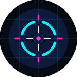</a>
  <br>
  Crosshair
  <br>
</h1>

<h4 align="center">A light, configurable crosshair overlay for FPS games on Android that never blocks your taps.</h4>

<p align="center">
  <a href="https://github.com/Bensalk/crosshair/releases/latest"></a>
  
  
  
  <a href="https://github.com/Bensalk/crosshair/actions"></a>
</p>

<p align="center">
  <a href="#key-features">Key Features</a> •
  <a href="#screenshots">Screenshots</a> •
  <a href="#how-to-use">How To Use</a> •
  <a href="#download">Download</a> •
  <a href="#building">Building</a> •
  <a href="CHANGELOG.md">Changelog</a> •
  <a href="#privacy--security">Privacy &amp; Security</a> •
  <a href="#related">Related</a> •
  <a href="#license">License</a>
</p>

<p align="center">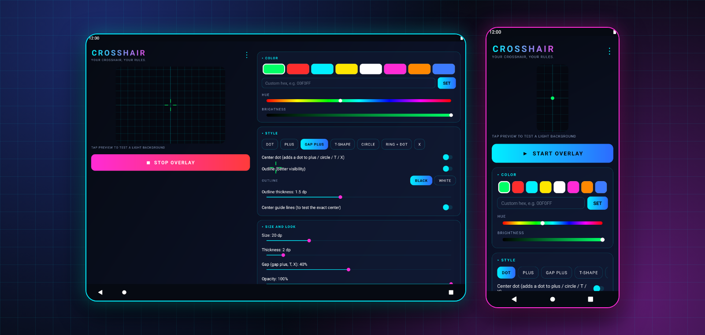</p>

Crosshair draws a crosshair exactly at the centre of your screen, on top of any app. Made by **Bensal** for FPS and shooter games such as COD Mobile, PUBG Mobile and Free Fire, with a neon cyan and magenta interface. New to Crosshair? Follow the [step-by-step guide](docs/HOW-TO-USE.md).

## Key Features

- **7 styles** – Dot, Plus, Gap plus, T-shape, Circle, Ring + dot and X, with an optional centre dot.
- **Full control** – size, thickness, gap and opacity sliders; outline in black or white with its own thickness.
- **Any colour** – quick swatches, hue and brightness sliders or a hex code, and your last custom colour saved as a swatch.
- **Taps pass through** – on Android 12+ the overlay stays under the system's touch limit, so every tap reaches the game.
- **Exact position** – separate offsets for portrait and landscape, switched automatically on rotate; + / − buttons for 1 dp steps (hold to repeat), *Center exactly* and *Fit size to screen*.
- **Presets** – three named slots; switch to the next preset, hide/show or stop from the notification without leaving the match.
- **Quick Settings tile** – start or stop from the notification shade; long-press to open the app.
- **Stays on** – comes back by itself if battery saver kills it, with banners to fix blocked notifications and battery optimisation.
- **Light on the game** – the overlay window is only as big as the crosshair, for smoother FPS and less battery.
- **Backup & restore** – a backup file in `Download/Crosshair`, auto-backup on every preset save, or copy settings as a code.
- **Device card** – model, Android version, screen size in px and dp, density and the exact crosshair position.
- **In-app changelog and About**, with a two-column layout on tablets.

## Screenshots

**Phone**

| Main screen | Colour & style | Size & look | Position |
|:---:|:---:|:---:|:---:|
| 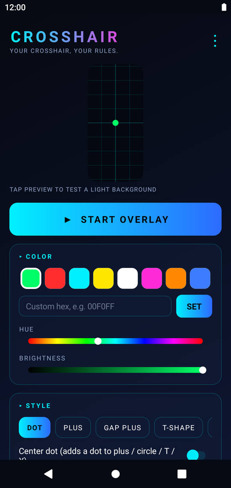 | 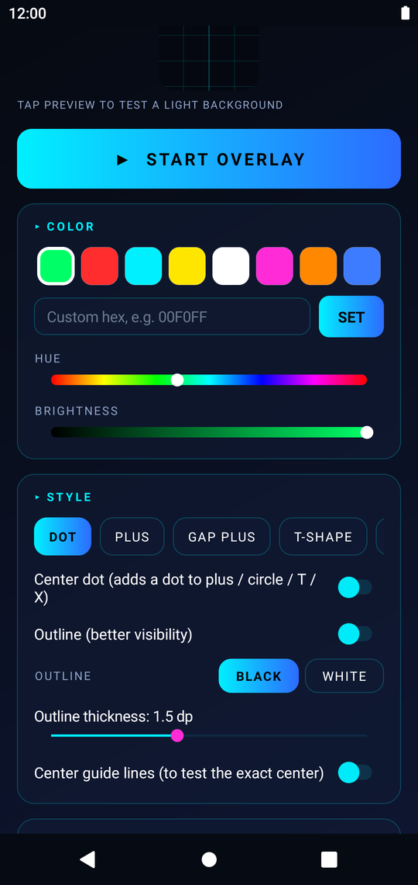 | 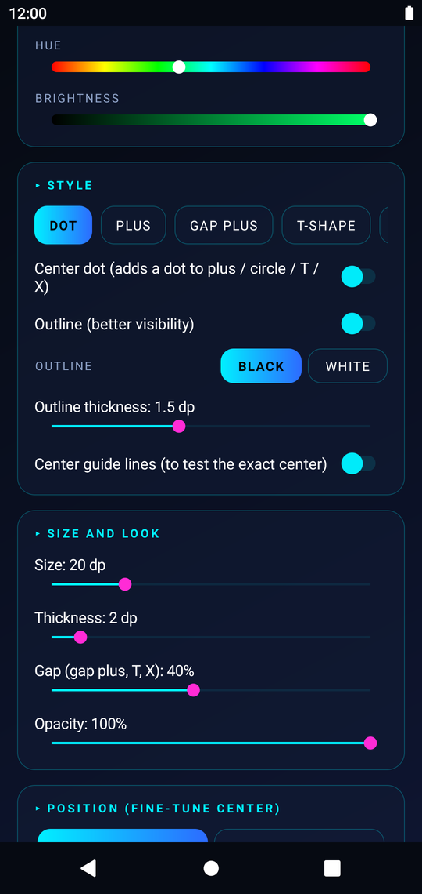 | 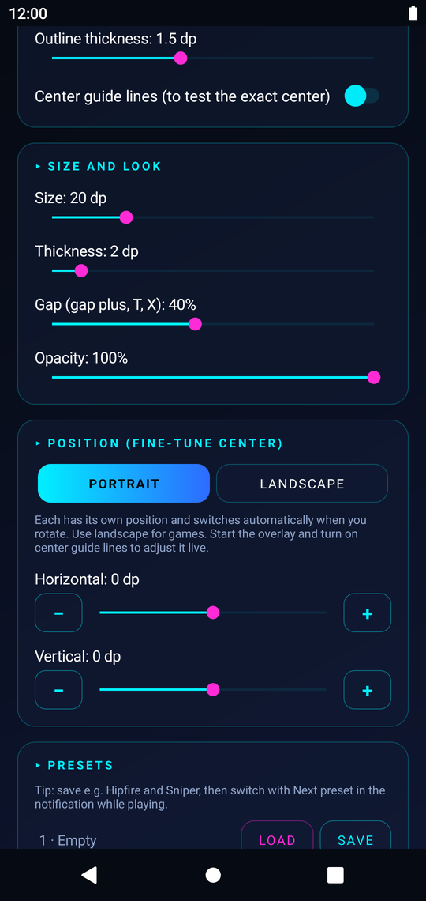 |
| **Presets** | **Device card** | **Menu** | **Changelog** |
| 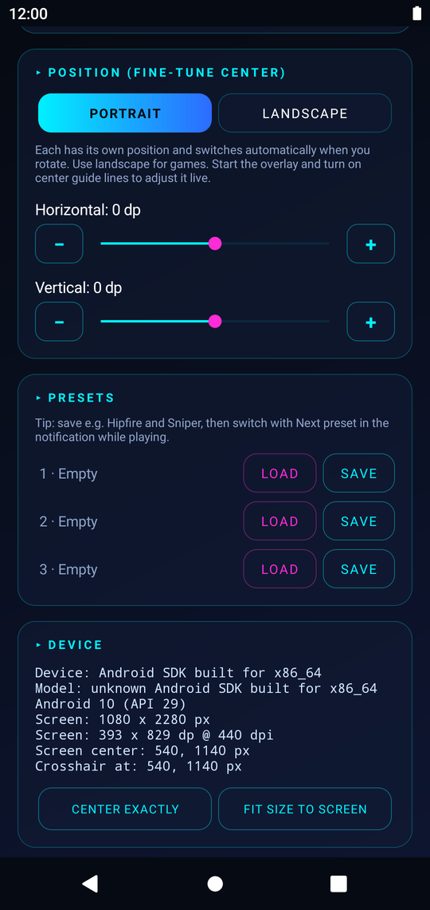 | 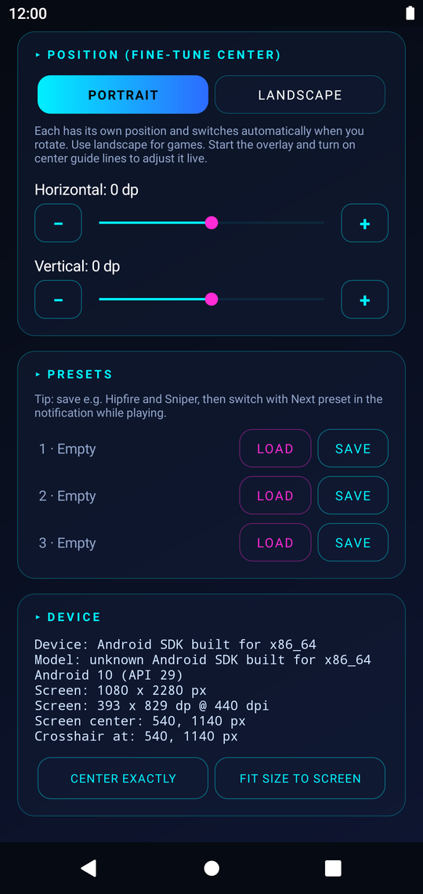 | 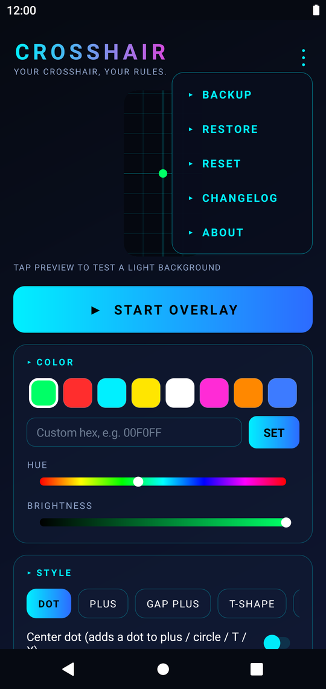 | 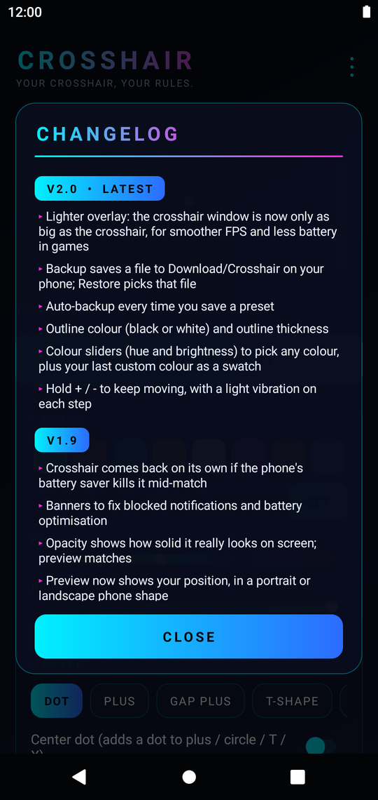 |

**In use**

| Overlay running | On top of other apps | Notification controls |
|:---:|:---:|:---:|
| 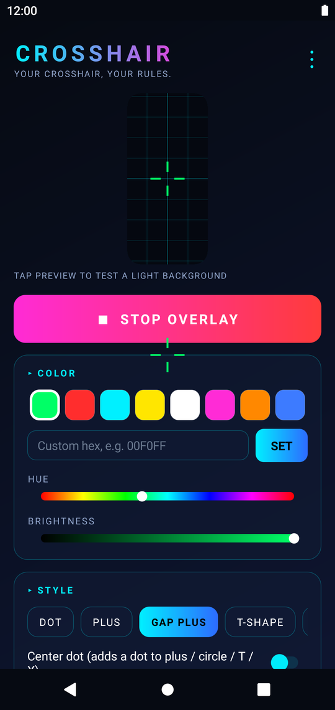 | 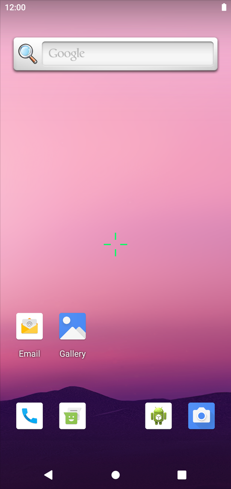 | 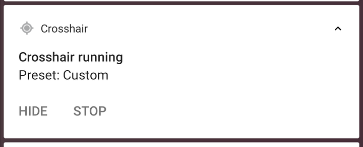 |

**Landscape (game mode)**

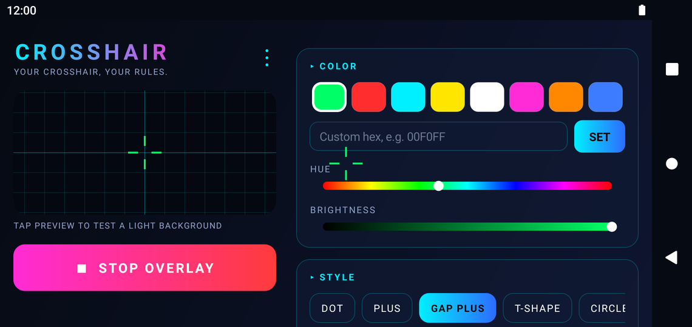

**Tablet** (two-column layout)

| Landscape | Portrait |
|:---:|:---:|
| 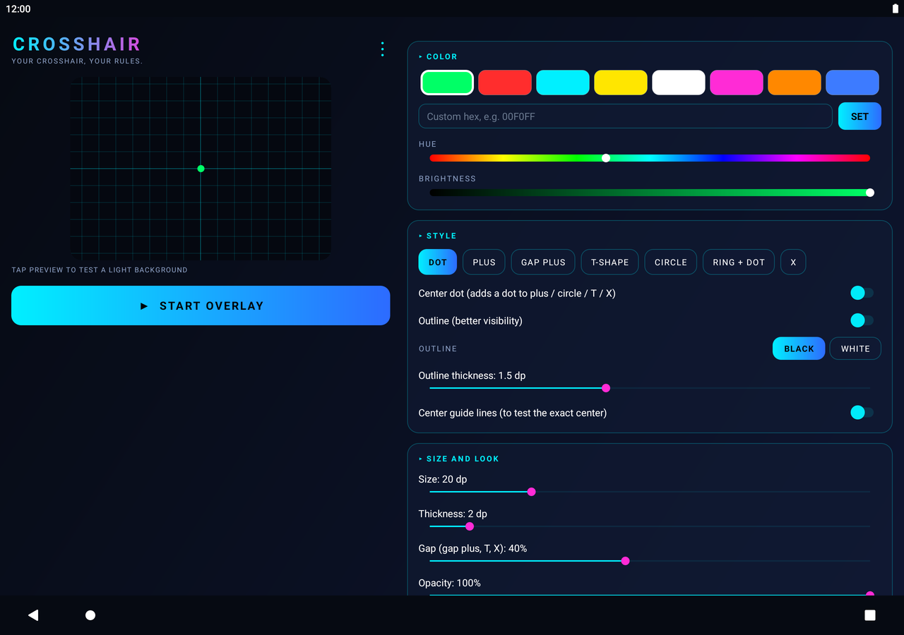 | 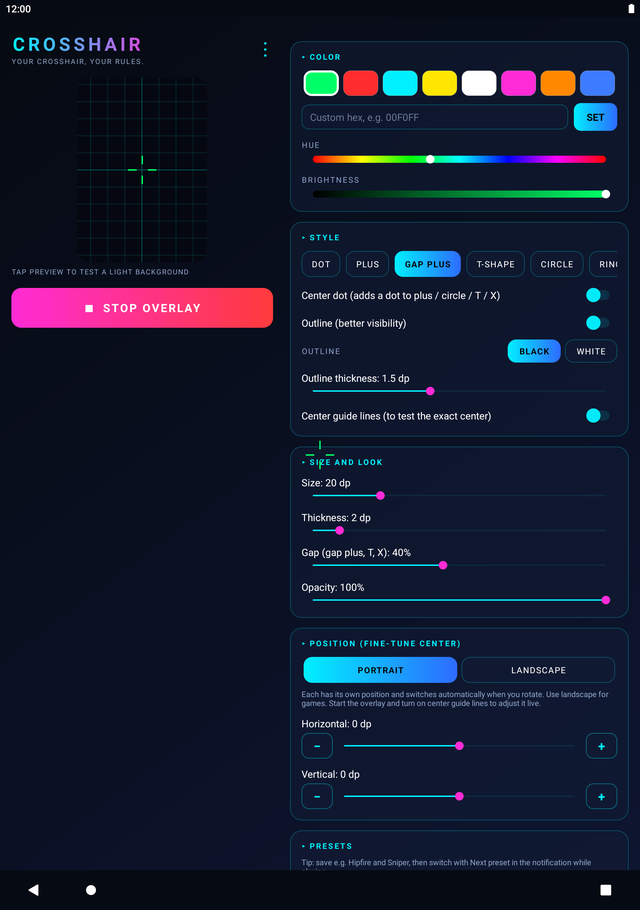 |

**The 7 styles**

<p align="center">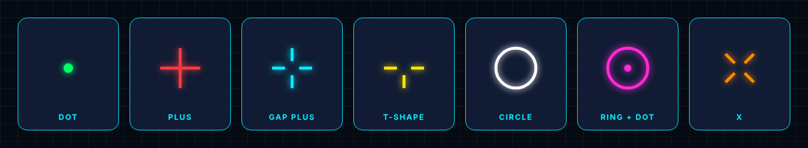</p>

> Screenshots are taken automatically from the real app on Android emulators (phone and tablet) by the [Screenshots workflow](.github/workflows/screenshots.yml). Run it again from the Actions tab after UI changes.

## How To Use

> 📖 **Full guide:** [docs/HOW-TO-USE.md](docs/HOW-TO-USE.md) covers permissions, lining it up with your game, presets, in-match controls, backup, tips for FPS games and troubleshooting.

**Quick start**

1. Install the APK from [Download](#download) (allow *Install unknown apps* for your browser or file manager if asked).
2. Open **Crosshair**, pick a style and colour, and adjust size, thickness, gap and opacity. The preview shows a portrait or landscape phone with your position.
3. Tap **Start**. Allow *Display over other apps* and notifications when Android asks.
4. Open your game. Fine-tune the position with + / − until it sits right on the game's aim point, then **save a preset**.
5. During a match use the notification buttons (**Next preset**, **Hide / Show**, **Stop**) or the Quick Settings tile.

> [!TIP]
> If the crosshair disappears mid-match, tap the battery banner in the app and set Crosshair to *Unrestricted* battery use.

## Download

- **Android 8.0+** – [crosshair-v1.0.apk](https://github.com/Bensalk/crosshair/releases/latest) from the latest release. Release notes are in [CHANGELOG.md](CHANGELOG.md).
- Updates install over the existing app and keep your settings and presets.

## Building

Every push builds a signed release APK on GitHub Actions; pushes to `main` that bump the version publish a new release.

```bash
# Requirements: JDK 17, Gradle 8.7, Android SDK 34
$ cd CrosshairOverlay
$ gradle assembleRelease
# CI signs with the KS_BASE64 and KS_PASS repository secrets
```

- Source: `CrosshairOverlay/app/src/main/java/com/example/crosshair/`
- Plain `android.widget` views built in code: no AndroidX, no Compose, no third-party libraries.
- Package `com.example.crosshair`, minSdk 26, targetSdk 34.

## Privacy & Security

- **No internet access.** The app does not have Android's internet permission, so it cannot send or receive anything.
- **No personal data.** It stores only your crosshair settings and preset names, in its own private storage that other apps cannot read. Nothing is sent to cloud backup.
- **Cannot see or control your screen.** The crosshair window ignores all touches (taps pass straight to your game) and cannot read what is on screen or what you type.
- **Permissions, and why:**

  | Permission | Why |
  |---|---|
  | Display over other apps | Draws the crosshair on top of the game |
  | Notifications / foreground service | Keeps the crosshair running and shows Next preset / Hide / Stop |
  | Ignore battery optimisation (optional) | Stops battery saver closing it mid-match |
  | Storage (Android 8–9 only) | Saves the backup file to Downloads |

- **Only install from this repo's [Releases](https://github.com/Bensalk/crosshair/releases).** Each release lists the APK's SHA-256 and the signing certificate, so you can check your download. The official signing certificate SHA-256 is:
  `FA:AC:5C:90:39:EB:34:24:8C:F2:4C:78:F6:7F:46:82:4E:91:27:A4:0A:A0:7E:D0:0A:95:30:2F:E7:19:73:E5`
  Android refuses updates signed with any other key, so a fake APK can't replace the real app.
- Found a security problem? See [SECURITY.md](SECURITY.md).

## Related

- [GST Calculator](https://github.com/Bensalk/gst-calculator) – Bensal's GST calculator for Android and Windows, using the same neon theme.

## License

Personal project by Bensal. All rights reserved. See [LICENSE](LICENSE).
